# Mantenimiento IPF - Trabajo Práctico N° 3 (Permisos Móviles)

Instituto Politécnico Formosa
Tecnicatura Superior en Desarrollo de Software Multiplataforma
Materia: Taller Complementario - React Native II
Alumno: Rodriguez, Gonzalo
Fecha de entrega: 17/10/2026

---

## Descripción general del proyecto

Esta aplicación fue desarrollada con React Native, TypeScript y Expo Router sobre Expo SDK 57 para resolver el sistema de reportes edilicios "Mantenimiento IPF". Permite que alumnos y docentes del Instituto Politécnico Formosa reporten desperfectos del edificio (electricidad, agua, mobiliario y equipos), escaneen el código QR del aula, adjunten fotos, indiquen el sector o ubicación del problema y reciban avisos cuando el reporte pasa a estado resuelto.

El diseño sigue el principio de mínimo privilegio y solicitud en contexto: al abrir la aplicación o el formulario de nuevo reporte no se pide ningún permiso. Cada permiso se solicita recién cuando la persona toca la función específica, mostrando antes una pantalla previa explicativa y ofreciendo siempre un camino alternativo manual si decide rechazarlo.

Las respuestas teóricas y prácticas de las Partes A a F se encuentran en el archivo `RESPUESTAS.md` en la raíz de este repositorio.

---

## Organización del proyecto y árbol de carpetas de `src/app`

El código fuente está organizado dentro de `src/` separando las rutas de navegación en `src/app`, los componentes reutilizables en `src/components`, los hooks personalizados en `src/hooks` y la lógica de permisos y estado en `src/lib`.

Para que Expo Router responda exactamente a las diez URLs pedidas en la consigna manteniendo las tres pestañas principales (`/`, `/avisos` y `/permisos`) sin agregar prefijos extras en la dirección, se utilizó el grupo de rutas `(tabs)` dentro del `Stack` principal:

```text
src/
├── app/
│   ├── _layout.tsx                 -> Stack raíz (define modales y pantallas fuera de tabs)
│   ├── ajustes-app.tsx             -> Ruta: /ajustes-app
│   ├── (tabs)/
│   │   ├── _layout.tsx             -> Configuración de las 3 pestañas inferiores
│   │   ├── index.tsx               -> Ruta: / (Tab "Reportes")
│   │   ├── avisos.tsx              -> Ruta: /avisos (Tab "Avisos")
│   │   └── permisos.tsx            -> Ruta: /permisos (Tab "Permisos")
│   ├── permisos/
│   │   └── [recurso].tsx           -> Ruta: /permisos/[recurso] (presentation: "modal")
│   └── reporte/
│       ├── nuevo.tsx               -> Ruta: /reporte/nuevo
│       ├── escanear.tsx            -> Ruta: /reporte/escanear
│       ├── foto.tsx                -> Ruta: /reporte/foto
│       ├── ubicacion.tsx           -> Ruta: /reporte/ubicacion
│       └── [id].tsx                -> Ruta: /reporte/[id]
├── components/
│   ├── ExplicacionPermiso.tsx      -> Pantalla previa y aviso de bloqueo por plataforma
│   ├── FilaPermiso.tsx             -> Tarjeta de estado y matiz para el panel /permisos
│   └── TarjetaReporte.tsx          -> Tarjeta de cada reporte en el listado inicial
├── hooks/
│   ├── usePermiso.ts               -> Hook unificado con los 4 estados y AppState
│   └── useRevisarAlVolver.ts       -> Hook que detecta el regreso desde Ajustes
└── lib/
    ├── permisos.ts                 -> Consultas, solicitudes, canal Android y ubicación
    └── reportesStore.tsx           -> Estado de reportes, borrador y bandeja de avisos
```

---

## Bloque `plugins` y configuración de `app.json` comentado

A continuación se detalla la configuración aplicada en `app.json` con comentarios explicativos sobre cada decisión de permisos, textos de propósito bajo el molde "Usamos tu [dato] para [beneficio concreto]" y bloqueo de permisos innecesarios:

```jsonc
{
  "expo": {
    "ios": {
      "bundleIdentifier": "ar.edu.ipf.mantenimiento",
      "infoPlist": {
        // Texto de propósito en iOS para cámara siguiendo el molde de la pauta 5.1.1
        "NSCameraUsageDescription": "Usamos tu cámara para escanear el código QR del aula y sacar fotos del desperfecto a reportar.",
        // Texto de propósito en iOS para ubicación solo cuando la app está en uso
        "NSLocationWhenInUseUsageDescription": "Usamos tu ubicación para identificar el sector del edificio donde se encuentra el desperfecto."
      }
    },
    "android": {
      "package": "ar.edu.ipf.mantenimiento",
      // Lista de permisos que se eliminan con tools:node="remove" en el AndroidManifest.xml
      "blockedPermissions": [
        "android.permission.RECORD_AUDIO",
        "android.permission.ACCESS_BACKGROUND_LOCATION",
        "android.permission.READ_EXTERNAL_STORAGE",
        "android.permission.WRITE_EXTERNAL_STORAGE",
        "android.permission.READ_MEDIA_IMAGES",
        "android.permission.READ_MEDIA_VIDEO",
        "android.permission.READ_MEDIA_AUDIO",
        "android.permission.SYSTEM_ALERT_WINDOW"
      ]
    },
    "plugins": [
      "expo-router",
      [
        "expo-camera",
        {
          // Texto de propósito para cámara
          "cameraPermission": "Usamos tu cámara para escanear el código QR del aula y sacar fotos del desperfecto a reportar.",
          // Desactivamos micrófono en iOS y Android porque solo leemos QR y sacamos fotos sin video
          "microphonePermission": false,
          "recordAudioAndroid": false
        }
      ],
      [
        "expo-location",
        {
          // Solo pedimos ubicación en primer plano; deshabilitamos segundo plano en ambas plataformas
          "locationWhenInUsePermission": "Usamos tu ubicación para identificar el sector del edificio donde se encuentra el desperfecto.",
          "locationAlwaysAndWhenInUsePermission": false,
          "isAndroidBackgroundLocationEnabled": false
        }
      ],
      [
        "expo-image-picker",
        {
          // Permitimos sacar foto en el momento, pero desactivamos micrófono y permiso de galería completa
          "cameraPermission": "Usamos tu cámara para sacar una foto del desperfecto que estás reportando.",
          "microphonePermission": false,
          "photosPermission": false
        }
      ],
      [
        "expo-notifications",
        {
          // Configura el ícono y color de las notificaciones locales en Android
          "icon": "./assets/images/icon.png",
          "color": "#1D4ED8"
        }
      ]
    ]
  }
}
```

### Justificación de cada permiso en `blockedPermissions`

1. `android.permission.RECORD_AUDIO`: La aplicación solo usa la cámara para escanear el código QR de las puertas de las aulas y tomar fotografías estáticas de los desperfectos. Como no graba video ni notas de audio, se bloquea para evitar que `expo-camera` o `expo-image-picker` lo agreguen al manifiesto.
2. `android.permission.ACCESS_BACKGROUND_LOCATION`: Para marcar en qué sector del Instituto (patio, estacionamiento o pasillo) está el problema alcanza con leer la ubicación una sola vez con la pantalla abierta en primer plano. No existe ningún seguimiento en segundo plano.
3. `android.permission.READ_EXTERNAL_STORAGE` y `android.permission.WRITE_EXTERNAL_STORAGE`: Son permisos antiguos de almacenamiento completo (API 32 o inferior) que no hacen falta porque para adjuntar una imagen guardada usamos el Photo Picker del sistema (`ImagePicker.launchImageLibraryAsync`).
4. `android.permission.READ_MEDIA_IMAGES`, `android.permission.READ_MEDIA_VIDEO` y `android.permission.READ_MEDIA_AUDIO`: Google Play restringe el acceso a toda la galería para apps que no son editores o administradores de fotos. Al usar el selector del sistema, el usuario elige una foto puntual sin abrir toda su biblioteca privada. En Android se quitan con `blockedPermissions`. La opción `photosPermission: false` de `expo-image-picker` es la de iOS: evita que se agregue `NSPhotoLibraryUsageDescription`.
5. `android.permission.SYSTEM_ALERT_WINDOW`: La aplicación no necesita superponer ventanas flotantes sobre otras aplicaciones del teléfono, por lo que se asegura su exclusión del manifiesto final de producción.

---

## Tabla de permisos del sistema

| Recurso | Módulo de Expo | Cuándo se pide | Alternativa si se deniega |
| :--- | :--- | :--- | :--- |
| **Cámara (Escáner QR)** | `expo-camera` (`useCameraPermissions`) | Recién cuando la persona entra a `/reporte/escanear` y toca el botón "Continuar" en la pantalla previa. | Escribir el código o nombre del aula a mano en el campo de texto de la misma pantalla o del formulario. |
| **Cámara (Sacar foto)** | `expo-image-picker` + `expo-camera` | Cuando la persona toca "Sacar foto" dentro de `/reporte/foto` y confirma "Continuar" en `/permisos/camara`. | Usar el botón "Elegir de la galería" que abre el selector del sistema sin permiso, o enviar el reporte sin foto. |
| **Fotos de galería** | `expo-image-picker` (`launchImageLibraryAsync`) | No pide permiso en ningún momento porque utiliza el Photo Picker nativo del sistema operativo. | El usuario selecciona solo la imagen que quiere compartir o carga el reporte sin adjuntar imagen. |
| **Ubicación en primer plano** | `expo-location` (`requestForegroundPermissionsAsync`) | Cuando la persona toca "Obtener ubicación actual en primer plano" en `/reporte/ubicacion` y avanza en `/permisos/ubicacion`. | Si es aproximada muestra "Ubicación aproximada" sin coordenadas exactas; si se deniega, elige el sector a mano (`Patio`, `Estacionamiento` o `Pasillo`). |
| **Notificaciones** | `expo-notifications` (`requestPermissionsAsync`) | Únicamente cuando la persona activa el interruptor "Avisarme cuando se resuelva mi reporte" en `/ajustes-app` (creando antes el canal `"reportes"` en Android). | Al tocar "Simular resolución" en `/reporte/[id]`: si el interruptor está activo y el permiso concedido, se programa una notificación local a los 10 segundos; si no, el aviso se guarda y se lee en la pestaña `/avisos` dentro de la app. |

---

## Auditoría del manifiesto (`npx expo prebuild --clean`)

Esta lista se obtuvo con `npx expo config --type introspect`, que equivale al `AndroidManifest.xml` que genera `npx expo prebuild --clean`, y se completó con los manifiestos propios de las librerías, que se fusionan al compilar.

| Permiso | Quién lo agrega | ¿Se quitó? |
| :--- | :--- | :--- |
| `android.permission.INTERNET` | Plantilla base de Expo | No |
| `android.permission.VIBRATE` | Plantilla base de Expo (no lo agrega `expo-notifications`) | No |
| `android.permission.CAMERA` | `expo-camera` y `expo-image-picker` | No (se usa para escanear y sacar fotos) |
| `android.permission.ACCESS_COARSE_LOCATION` | `expo-location` | No |
| `android.permission.ACCESS_FINE_LOCATION` | `expo-location` | No |
| `android.permission.RECEIVE_BOOT_COMPLETED` | Manifiesto propio de `expo-notifications` (se fusiona al compilar) | No |
| `android.permission.POST_NOTIFICATIONS` | Manifiesto propio de `expo-notifications` (se fusiona al compilar) | No |
| `android.permission.READ_EXTERNAL_STORAGE` | Plantilla base y `expo-image-picker` / `expo-file-system` | Sí, con `blockedPermissions` |
| `android.permission.WRITE_EXTERNAL_STORAGE` | Plantilla base y `expo-image-picker` / `expo-file-system` | Sí, con `blockedPermissions` |
| `android.permission.READ_MEDIA_IMAGES` | Ninguna librería instalada lo declara | Sí, con `blockedPermissions`, por prevención (aparece con `tools:node="remove"`) |
| `android.permission.READ_MEDIA_VIDEO` | Ninguna librería instalada lo declara | Sí, con `blockedPermissions`, por prevención (aparece con `tools:node="remove"`) |
| `android.permission.READ_MEDIA_AUDIO` | Ninguna librería instalada lo declara | Sí, con `blockedPermissions`, por prevención (aparece con `tools:node="remove"`) |
| `android.permission.ACCESS_BACKGROUND_LOCATION` | `expo-location`, solo si `isAndroidBackgroundLocationEnabled` es `true` (acá es `false`) | Sí, con `blockedPermissions`, por prevención (aparece con `tools:node="remove"`) |
| `android.permission.SYSTEM_ALERT_WINDOW` | Plantilla base de Expo (y React Native en las builds de depuración) | Sí, con `blockedPermissions` (aparece con `tools:node="remove"`) |
| `android.permission.RECORD_AUDIO` | `expo-camera`, salvo que `recordAudioAndroid` sea `false` (acá es `false`) | Sí, con `blockedPermissions`, por prevención (aparece con `tools:node="remove"`) |

---

## Guía de pruebas y capturas de los estados requeridos

Para ejecutar el proyecto en entorno local se instalan las dependencias con `npx expo install` y se inicia el servidor de desarrollo con `npx expo start` (para Expo Go) o se genera la compilación nativa de desarrollo con `npx expo prebuild --clean` seguido de `npx expo run:android` / `npx expo run:ios`.

1. **Escáner en sus cuatro estados (`/reporte/escanear`)**: Al abrir la pantalla por primera vez, el hook muestra brevemente el estado `cargando` con el `ActivityIndicator`, luego pasa a `preguntable` mostrando el componente `ExplicacionPermiso` con el botón "Continuar" y el campo inferior para escribir el aula a mano. Al tocar "Continuar" y aceptar en el diálogo del sistema pasa al estado `concedido` mostrando `CameraView` con el lector QR. Si en cambio se rechaza hasta agotar los intentos, pasa al estado `bloqueado` mostrando el camino exacto en Ajustes para Android o iOS y el botón "Abrir Ajustes".
2. **Ubicación concedida, aproximada y denegada (`/reporte/ubicacion`)**: Si se concede con precisión fina, registra las coordenadas y el sector; si el usuario elige ubicación aproximada (`android.accuracy === 'coarse'` en Android o `ios.accuracy === 'reduced'` en iOS), guarda `"Ubicación aproximada (Sector: ...)"` sin exponer coordenadas exactas; y si se deniega, permite tocar "Guardar solo con el sector elegido a mano".
3. **Foto desde el selector del sistema (`/reporte/foto`)**: Al tocar "Elegir de la galería", se ejecuta `ImagePicker.launchImageLibraryAsync` abriendo el Photo Picker nativo del teléfono y cargando la vista previa de la foto en el formulario sin mostrar ningún diálogo de permiso.
4. **Notificación recibida y alternativa (`/ajustes-app`, `/reporte/[id]` y `/avisos`)**: El permiso de notificaciones se pide solo desde el interruptor de `/ajustes-app`: al activarlo se abre la pantalla previa y, al tocar "Continuar", se crea el canal `"reportes"` en Android y se muestra el diálogo del sistema. Luego, al entrar a un reporte en `/reporte/[id]` y tocar "Simular resolución", si el interruptor está activo y el permiso concedido, se programa una notificación local que aparece a los 10 segundos. Si no, el aviso queda en la bandeja `/avisos`.
5. **Panel de permisos antes y después de volver de Ajustes (`/permisos`)**: En la pestaña `/permisos` se observa cada recurso con su estado (`cargando`, `concedido`, `preguntable` o `bloqueado`), la plataforma (`Platform.OS`) y el matiz (en ubicación, "precision: aproximada" o "precision: exacta"). La fila de notificaciones no pide el permiso desde el panel: su botón lleva a `/ajustes-app`. Al tocar "Abrir Ajustes", cambiar un permiso en el teléfono y volver a la aplicación, `usePermiso` vuelve a consultar el estado al ganar el foco la pantalla y cuando `useRevisarAlVolver` detecta el paso de `AppState` a `'active'`, así que el panel se actualiza solo.

El hook `usePermiso(recurso)` devuelve `estado` (`'cargando'`, `'concedido'`, `'preguntable'` o `'bloqueado'`), `parcial`, `matiz`, `pedir`, `consultar` y `abrirAjustes`. No se implementaron las notificaciones provisionales de iOS (el desafío opcional de G4).

**Notificaciones en Expo Go (Android):** con `expo-notifications` 57.0.23, importar la librería en Expo Go para Android tira el error `Cannot find native module 'ExpoTopicSubscriptionModule'`, porque Expo Go ya no trae los módulos de notificaciones push. Si se importa de forma normal, se cae toda la app. Por eso `src/lib/permisos.ts` carga la librería dentro de un `try/catch`: si no se puede cargar, el panel muestra las notificaciones como "no disponible en Expo Go" y "Simular resolución" deja el aviso en `/avisos`. La notificación local de los 10 segundos se prueba en una development build (o en Expo Go de iOS).

---

## Capturas

Las capturas están en la carpeta `capturas/`.

**Escáner en sus cuatro estados**

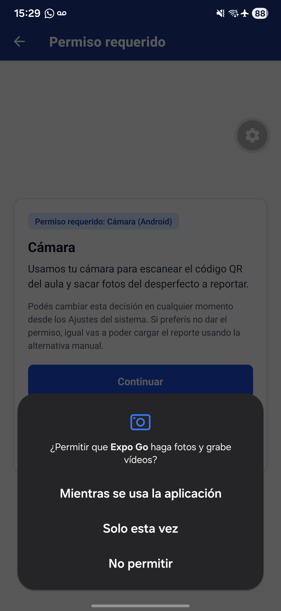
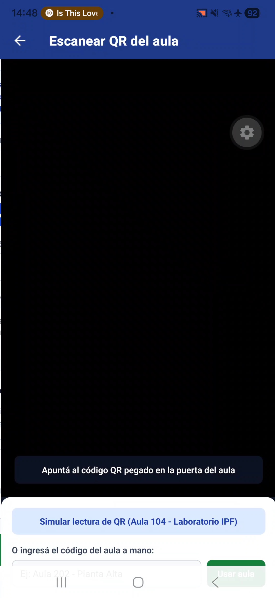
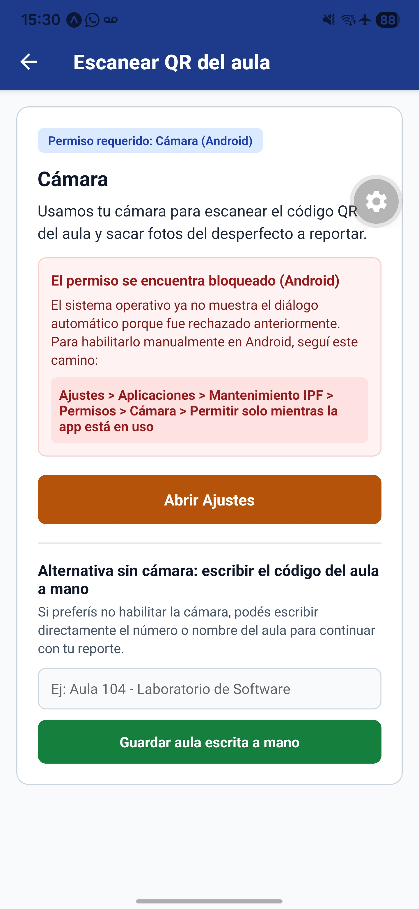

El estado `cargando` no tiene captura: dura una fracción de segundo mientras la app consulta el permiso al abrir la pantalla, y en el dispositivo de prueba no alcanzó a grabarse.

**Ubicación**

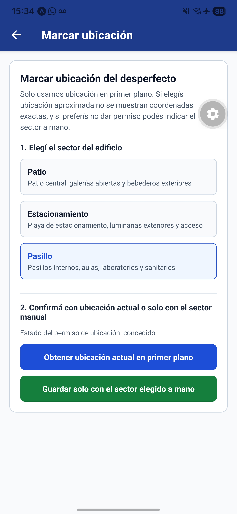
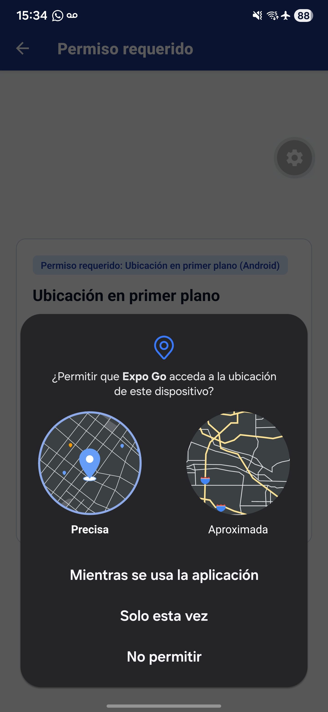

Si se deniega el permiso dos veces, el panel de permisos muestra la ubicación como "Bloqueado" y ofrece la alternativa manual:

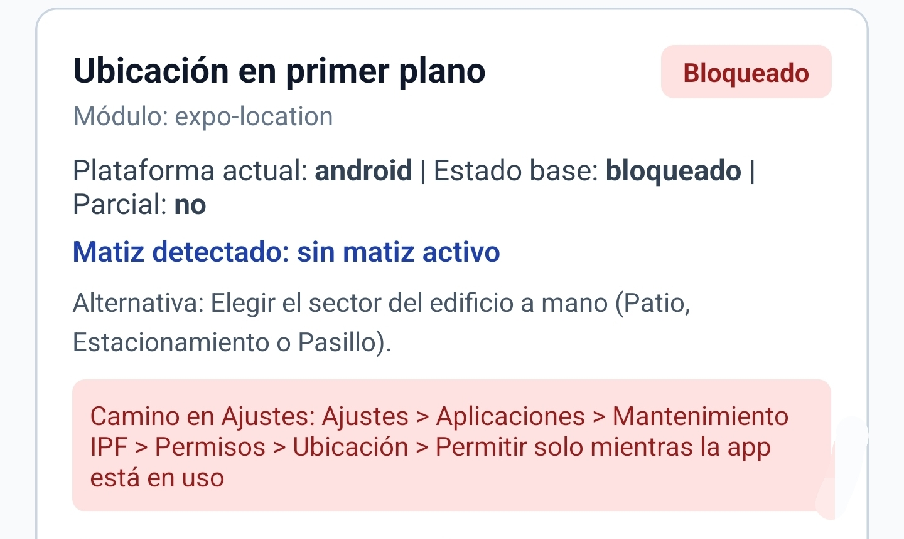

**Foto desde el selector del sistema**

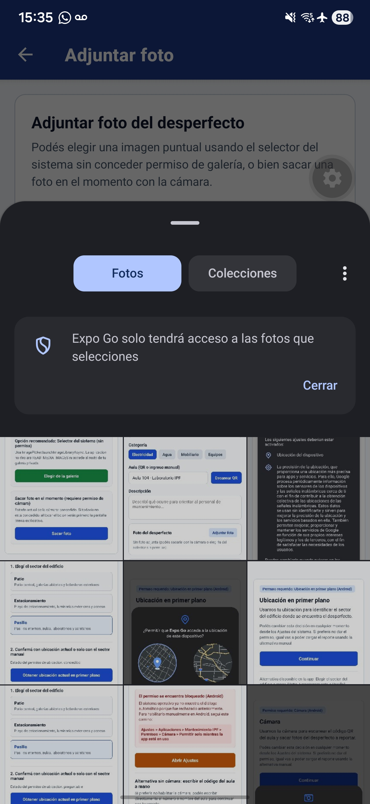

Con la foto ya elegida, el formulario muestra la vista previa:

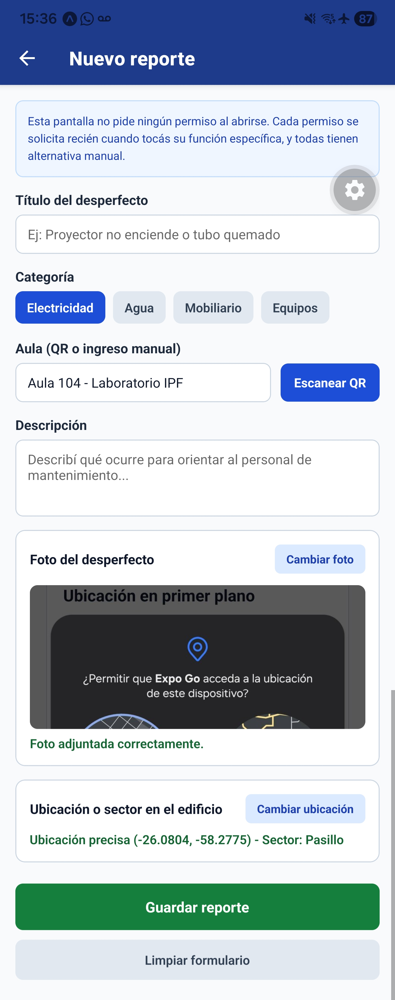

**Notificación recibida**

En la development build, con el permiso concedido y el interruptor activo, "Simular resolución" programa la notificación local y aparece a los 10 segundos:

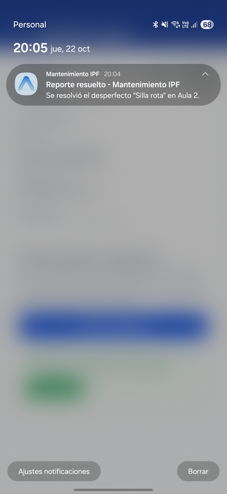

En Expo Go para Android la notificación local no se puede probar, así que ahí se usa el camino alternativo: el aviso queda en la bandeja de Avisos.

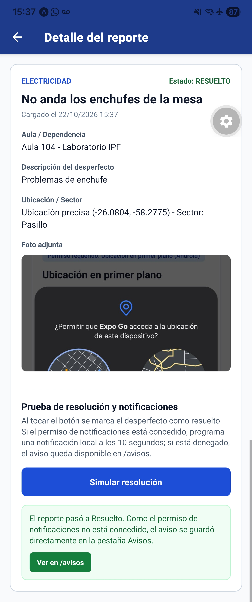

La bandeja de Avisos guarda el aviso, y el interruptor de `/ajustes-app` muestra que el permiso de notificaciones está bloqueado:

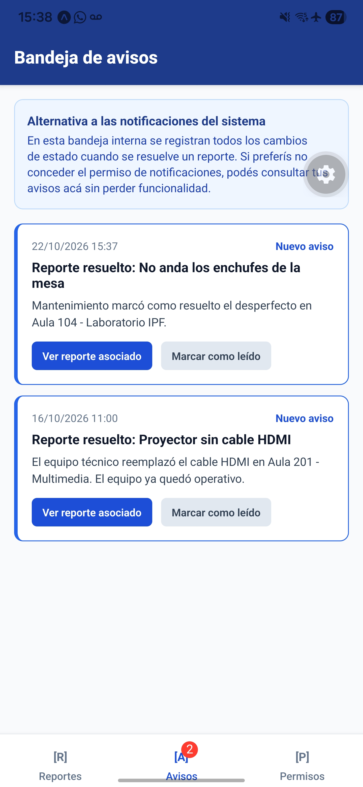
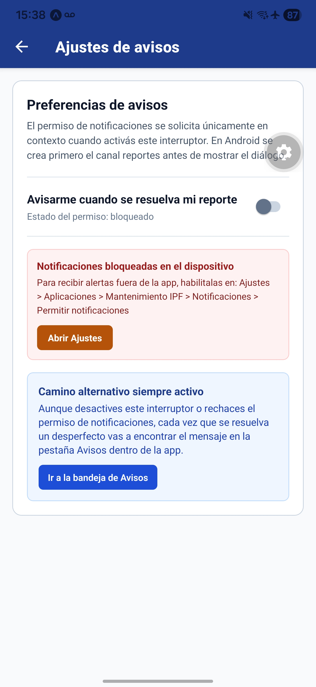

**Panel de permisos antes y después de volver de Ajustes**

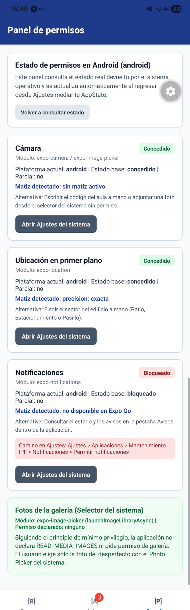
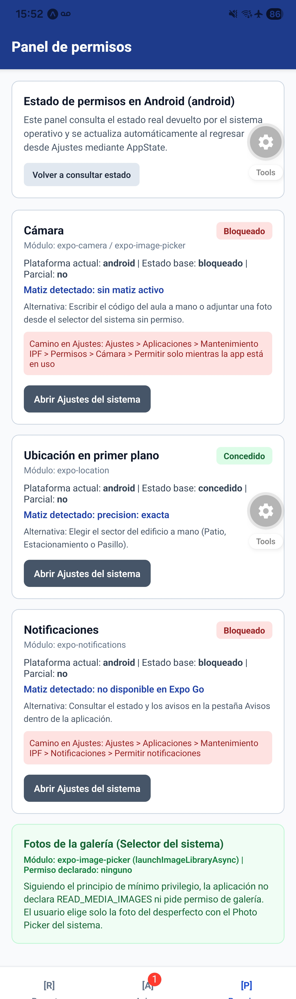

Si el permiso de ubicación se quita en Ajustes pero el sistema todavía permite pedirlo, el panel muestra "Preguntable":

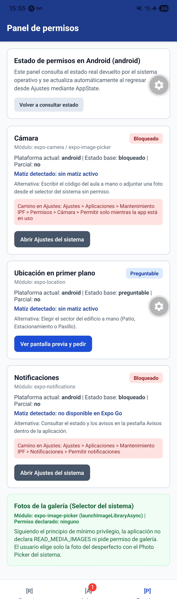

## Diálogo del sistema (development build)

Captura del diálogo del sistema en la development build. En Android el diálogo no muestra un texto de propósito propio (eso es de iOS), pero sí el nombre de nuestra app, "Mantenimiento IPF", en lugar de "Expo Go":

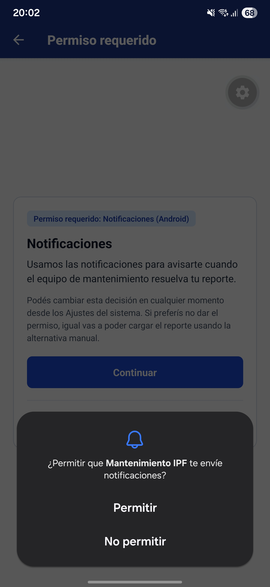

---

## Respuestas sobre el código para la defensa oral (G6)

**1. Código que decide entre "Continuar" y "Abrir Ajustes" y qué campo lo decide:**
En `src/components/ExplicacionPermiso.tsx` (usado por `/permisos/[recurso].tsx` y `/reporte/escanear.tsx`), la decisión se toma con `const estaBloqueado = estado === 'bloqueado';`. Ese `estado` sale de `calcularEstado()` en `src/lib/permisos.ts`, que mira dos campos de la respuesta de Expo: `granted` y `canAskAgain`. Si `granted` es `false` y `canAskAgain` es `true`, el estado es `preguntable`: el botón muestra `"Continuar"` y llama a `pedir()`. Cuando `canAskAgain` pasa a `false`, el estado es `bloqueado`: el botón cambia a `"Abrir Ajustes"` y llama a `Linking.openSettings()`.

**2. Qué hace Android al revocar la cámara desde Ajustes con la app abierta y cómo se entera el código:**
Cuando el permiso estaba concedido y la persona lo revoca desde Ajustes, Android termina (mata) el proceso de la app por seguridad y al volver la recrea leyendo el nuevo estado denegado. En cambio, cuando el permiso estaba bloqueado y la persona lo habilita en Ajustes y vuelve a la app, el proceso sigue vivo; ahí nuestro código se entera gracias al hook `src/hooks/useRevisarAlVolver.ts`, que escucha `AppState.addEventListener('change', ...)` y cuando detecta que pasa de `inactive` o `background` a `'active'`, vuelve a ejecutar `consultar()`.

**3. Por qué la app no pide permiso para elegir una foto, pero sí para sacarla:**
En `src/app/reporte/foto.tsx`, el botón "Elegir de la galería" llama a `ImagePicker.launchImageLibraryAsync()`, que delega la selección al Photo Picker propio del sistema operativo, de modo que la app solo recibe la foto que el usuario tocó sin poder ver el resto de su galería. En cambio, "Sacar foto" necesita encender el sensor físico de la cámara en vivo desde la app, lo cual siempre requiere el permiso de tiempo de ejecución `CAMERA`.

**4. Qué cambia en la app si la persona elige ubicación aproximada o si la deniega:**
En `src/lib/permisos.ts` (`obtenerUbicacion`) y `src/app/reporte/ubicacion.tsx`, si la persona elige ubicación aproximada (`permiso.android?.accuracy === 'coarse'` en Android o `permiso.ios?.accuracy === 'reduced'` en iOS, función `esUbicacionAproximada`), `datos.aproximada` vale `true` y el reporte guarda el texto `"Ubicación aproximada (Sector: ...)"` sin mostrar coordenadas exactas. Si la persona deniega el permiso, `obtenerUbicacion()` devuelve `null` sin romper la app y el usuario guarda el reporte eligiendo el sector (`Patio`, `Estacionamiento` o `Pasillo`) a mano.

**5. Por qué los textos de propósito no aparecen en Expo Go:**
Porque iOS lee las claves `NSCameraUsageDescription` y `NSLocationWhenInUseUsageDescription` desde el archivo `Info.plist` compilado dentro del binario instalado. Al abrir el proyecto en Expo Go, el binario instalado es Expo Go y no nuestra propia compilación, por lo que recién se ven nuestros textos en español al compilar una development build propia.

**6. Si mañana agregamos la nota de voz, ¿alcanza con publicar una actualización OTA?**
No alcanza con una actualización OTA. Para grabar notas de voz con `expo-audio` necesitamos agregar el permiso `android.permission.RECORD_AUDIO` en el `AndroidManifest.xml` y la clave `NSMicrophoneUsageDescription` en el `Info.plist` de iOS, además del código nativo del módulo. Como las actualizaciones OTA solo envían el bundle de JavaScript y no pueden modificar archivos nativos firmados del binario, es obligatorio generar una nueva build nativa y subirla a las tiendas.
